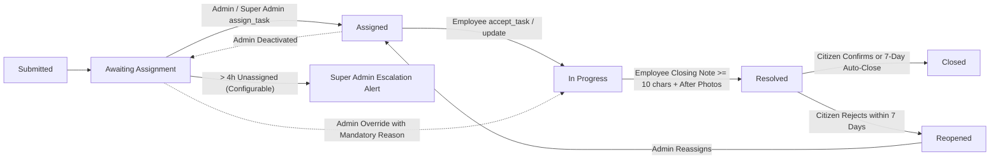

# Citizen Grievance Analysis System

## Live Project Link

https://smart-governance.streamlit.app/

## Project Overview

An **AI-assisted, role-based civic grievance portal** built with Python, Streamlit, SQLite, Plotly Express, and Pillow. Citizens select the target department, attach optional EXIF-scrubbed photo evidence, and track status/history; employees manage complaints assigned to them within their department; administrators oversee assignments, escalations, and SLA performance; and super administrators manage users, departments, and SLA policies.

---

## Quick Start

```bash
cd citizen_grievance_project
pip install -r requirements.txt
streamlit run app.py
```

### Seeded Demo Accounts (change default passwords before going live!)

| Role | Username | Password | Department |
|---|---|---|---|
| Super Admin | `superadmin` | `Admin@123` | - |
| Admin | `admin` | `Admin@123` | - |
| Employee | `employee` | `Admin@123` | `Water` |

Public citizens self-register via the **Sign Up** tab (creates a `user` account only).

---

## Project Structure

```
citizen_grievance_project/
├── .streamlit/
│   └── config.toml             <- Native Light / Dark / System theme config
├── app.py                      <- Entry point, auth, forced password reset, role router
├── complaints.db               <- SQLite database (auto-initialized & migrated)
├── uploads/                    <- Local attachment storage (gitignored; served via Python bytes)
├── requirements.txt
├── README.md
│
├── core/
│   ├── permissions.py          <- PERMISSIONS table, can(), require()
│   ├── security.py             <- PBKDF2-HMAC-SHA256 hashing, temp passwords, text sanitization
│   ├── database.py             <- SQLite schema, migrations, demo, SLA & location tables
│   ├── departments.py          <- Active/all department lookup and Super Admin CRUD
│   ├── locations.py            <- India Post CSV loader, pincode lookup, AP hierarchy & validation
│   ├── auth.py                 <- Register, login, jurisdiction assignment, admin lifecycle
│   ├── images.py               <- Pillow validation, EXIF/GPS stripping, initial/after stage RBAC
│   ├── sla.py                  <- SLA policies, due_at calculation, escalations, auto-close
│   ├── complaints.py           <- Submission, jurisdiction routing, assign_task, accept_task, updates
│   ├── oversight.py            <- Super Admin metrics, >4h unassigned escalations, filtered audit log
│   ├── analytics_geo.py        <- District/mandal/pincode filters, hotspot points, public metrics (<5 suppressed)
│   ├── performance.py          <- Per-department, per-employee, and employee self metrics
│   ├── priority_rules.py       <- Configurable duration thresholds & YAML audit log
│   └── classifier.py           <- Duration + emergency + ML + keyword priority inference
│
├── data/
│   └── india_post_pincodes_ap.csv <- Official data.gov.in India Post directory for Andhra Pradesh
│
├── scripts/
│   ├── load_locations.py       <- Idempotent official India Post CSV loader & reporter
│   └── run_escalations.py      <- Standalone CLI runner for cron / Task Scheduler
│
├── ui/
│   ├── shared.py               <- Theme-aware CSS, shared dashboard, hotspot map, assign/override UI
│   ├── citizen.py              <- Department picker, AP pincode/cascading location, photo upload & feedback
│   ├── employee.py             <- Assigned tasks dashboard, Accept Task, closing remark & "after" photos
│   ├── admin.py                <- District-scoped queue, assign_task, mandatory-reason status overrides
│   └── super_admin.py          <- Oversight, alerts, user/admin jurisdiction, locations, SLA, rules & ML
│
└── tests/
    ├── test_permissions.py           <- End-to-end permission, image, SLA, escalation & migration tests
    ├── test_duration_priority.py     <- Duration extractor, YAML rules & priority precedence tests
    ├── test_ml.py                    <- ML classifier, evaluation & artifact tests
    └── test_hierarchy_jurisdiction.py <- AP pincode/location, jurisdiction, assign, override & oversight tests
```

---

## Roles & Permissions

| Permission | user | employee | admin | super_admin | Scope / Rules |
|---|---|---|---|---|---|
| `submit_complaint` | Yes | No | No | No | Citizen picks active department; auto-assigns least-loaded employee |
| `view_own` | Yes | - | - | - | Citizens see only their own complaints |
| `add_images` | Yes | No | No | No | Own open complaint only (not Resolved/Closed); max 3 photos |
| `submit_feedback` | Yes | No | No | No | Own Resolved complaint only, within 7 days, once per cycle |
| `view_all` | No | Yes | Yes | Yes | Employee sees own department only; Admin/Super Admin see all |
| `assign_task` / `assign_complaint` | No | No | Yes | Yes | Assign/reassign with due date & instructions to matching dept + jurisdiction employee |
| `accept_task` | No | Yes | No | No | Employee explicitly accepts an assigned task and logs acceptance |
| `update_task_status` / `update_status_remark` | No | Yes | Yes | Yes | Employee only on tasks assigned to them; Admin status override requires mandatory reason |
| `claim_complaint` | No | Yes | No | No | Disabled by default; works only when Admin enables `allow_self_claim` for that district & employee matches dept + district |
| `edit_complaint_fields` | No | No | Yes | Yes | Change department and priority (recalculates SLA); employees blocked (`PermissionError`) |
| `remove_image` | No | No | Yes | Yes | Soft delete with confirmation + audit row |
| `delete_complaint` | No | No | No | Yes | Soft delete with confirmation + audit row |
| `manage_users` | No | No | No | Yes | Create any role, deactivate/reactivate, change role, reset password |
| `manage_admins` | No | No | No | Yes | Create Admins, set/update district & department jurisdiction, hand off districts |
| `view_admin_oversight` | No | No | No | Yes | View Admin KPIs, >4h unassigned escalations, and filtered Admin audit logs |
| `manage_locations` | No | No | No | Yes | Inspect location stats and reload official India Post CSV mappings |
| `manage_departments` | No | No | No | Yes | Add, rename, deactivate, reactivate (never hard-deleted) |
| `manage_sla` | No | No | No | Yes | Configure target resolution hours per department & priority |
| `manage_priority_rules` | No | No | No | Yes | Edit `config/priority_rules.yaml` thresholds & aging (audit-logged) |
| `manage_ml` | No | No | No | Yes | Train candidate models (never auto-activated) and manually promote |
| `view_review_queue` | No | No | Yes | Yes | Inspect ML low-confidence, mismatch, and low-duration-confidence items |
| `resolve_review_item` | No | No | Yes | Yes | Accept ML/citizen department and record priority feedback |
| `view_analytics` | No | Yes (own scope) | Yes | Yes | View complaint analytics, location filters, and hotspot maps |
| `support_complaint` | Yes | No | No | No | Citizens can support open local issues |
| `view_public_dashboard` | Public | Public | Public | Public | Anonymized district transparency metrics (suppresses `< 5` groups, zero PII) |

> All permissions and scopes are enforced in the service layer (`core/`), not only in the UI.

---

## Duration-Aware Priority Engine (`config/priority_rules.yaml`, `nlp/duration.py`)

### 1. Default Duration Thresholds & Essential Service Overrides

Configured in `config/priority_rules.yaml` and editable live by Super Admin in the **Priority Rules** tab (every change writes to `priority_rule_audit`):

| Scope | Low | Medium | High |
|---|---|---|---|
| **Default** | `< 24 hours` | `24 hours up to < 7 days (168h)` | `>= 7 days (168h)` |
| **Water & Electricity Overrides** | `< 24 hours` | `>= 24 hours (1 day / since yesterday)` | `>= 5 days (120h)` |

- **Duration Extraction (`nlp/duration.py`):** Deterministic multilingual extractor supporting English, Telugu, Hindi, and mixed transliterated text — including digits (ASCII, Devanagari `०-९`, Telugu `౦-౯`), number words up to `30+`, abbreviations/typos (`dys`, `wks`, `hrs`), ranges (`2 to 3 days`, `3-4 days` using upper bound), relative idioms (`since yesterday` = 24h, `since morning` = 8h, `since last night` = 12h, `since last week` = 168h, `from last month` = 720h, `for ages` = 168h low-confidence flagged for review), and context filtering to ignore irrelevant durations (`salary`, `ticket valid for`, `call me after`, `festival`, `"fixed X days ago but broke again"`).
- **Recurring Detection:** Patterns such as `"every week"`, `"twice a month"`, `"हर हफ्ते"`, `"ప్రతి రోజు"` set `is_recurring = True` and bump final priority by **+1 level** instead of converting to a single outage duration.
- **Open Priority Aging (`core/sla.py:run_priority_aging_check`):** Separate from text rules — unresolved complaints age upward automatically (`Low -> Medium` after **3 days**, `Medium -> High` after **7 days**), writing `actor = "system"` rows to `complaint_updates` and never lowering priority.

### 2. Final Priority Rule (Deterministic + ML Hybrid Precedence)

```text
final_priority = highest_priority_of([
  1. Emergency keyword override (fire, explosion, electrocution, flood, injury, death, gas leak, live wire) -> High
  2. Duration-based priority from config/priority_rules.yaml
  3. ML model priority (word + char TF-IDF + extracted duration/recurrence features)
  4. Keyword priority (core/classifier.py)
])
then apply:
  5. Recurring pattern escalation (+1 level if recurring, capped at High)
```

> **Safety Guarantee:** No ML model prediction can ever lower a priority established by Emergency Keywords (Rule 1) or Duration Thresholds (Rule 2). Staff see the extracted duration, confidence, and `priority_reason` directly on each ticket; low-confidence duration extractions (`< 0.55`) enter `review_queue`, and unparsed time cues log to `duration_extraction_logs`.

### 3. Design Assumptions

- **Water & Electricity 24h Override Harmony:** Because essential-service overrides are meant to escalate *faster* than defaults and unit expectations require `"no water since yesterday"` (`24h`) to evaluate to `Medium` for Water, Water and Electricity keep `medium_min_hours: 24.0` while lowering `high_min_hours` to `120.0` (5 days vs 7-day default).
- **Month / Year Normalization:** `"1 month"` / `"from last month"` normalizes to `720.0` hours (`30 * 24`), and `"1 year"` normalizes to `8760.0` hours (`365 * 24`).
- **Offline Zero-Crash Policy:** Text classification uses local TF-IDF + Duration features (`ml/models/`) and falls back cleanly to keyword/duration rules when no trained model artifact is present.
- **Synthetic Training & Gold Set Isolation:** `data/synthetic_complaints.csv` contains 8,700 100% synthetic rows (`is_synthetic=True`) generated with `template_group` grouping (`StratifiedGroupKFold`); `tests/gold_priority_cases.csv` (339 hand-written cases) is strictly held out for unbiased evaluation (`docs/priority_evaluation.md`).

---

## Hierarchical Workflow & Jurisdiction (Andhra Pradesh Default)

### Workflow State Machine



### Location Data Source & Structure (`DEFAULT_STATE=Andhra Pradesh`)

- **Official Source:** India Post All-India Pincode Directory from **data.gov.in** (Open Government Data Platform India, resource ID `5c2f62fe-5afa-4119-a499-fec9d604d5bd`), filtered to `Andhra Pradesh` and saved to `data/india_post_pincodes_ap.csv`.
- **Download Date:** `2026-11-28` (`10,681` rows covering `26` official Andhra Pradesh districts, `10,457` normalized post offices/areas, and `8,404` rows with latitude/longitude centroids; zero synthetic location records).
- **Mandal Level Handling:** Because the official `data.gov.in` India Post CSV does not include a `mandal` / `taluk` column, `scripts/load_locations.py` and `core/locations.py` cleanly skip populating `mandals` when that column is absent (logging `"Skipped mandal level: source CSV lacks mandal/taluk column"` in `location_load_logs`) while supporting `mandal` seamlessly whenever a regional CSV supplies one.
- **Citizen Location Capture:** Supports both **6-digit Pincode Lookup** (auto-fills State & District, lets citizen confirm the specific area) and **Cascading Dropdowns** (State -> District -> optional Mandal -> Area, auto-filling pincode), plus optional map pin/landmark. Every submitted complaint stores `state_id`, `district_id`, `mandal_id` (if applicable), `area_id`, and validated `pincode`, falling back to area centroid coordinates when no pin is dropped.

### Jurisdiction, Oversight & Assumptions

- **Super Admin (Top Oversight):** Unscoped nationwide visibility, **Admin Oversight** metrics (`awaiting_assignment`, `avg_time_to_assign`, district overdue count, reassignments, status overrides), automatic **Unassigned Escalation Alerts** after `CGS_UNASSIGNED_ESCALATION_HOURS` (default `4`), district handoff between Admins, Admin deactivation (returns open district complaints cleanly to `Awaiting Assignment` while preserving full history), and filtered Audit Logs by Admin/District.
- **Admin (District + Optional Department Manager):** Scoped strictly via `admin_jurisdictions`. District complaints enter `Awaiting Assignment` (no silent auto-assign) with a suggested least-loaded active employee in the matching department + jurisdiction. Admins can `assign_task` (with due date and instructions), edit department/priority, and override status ONLY with a mandatory audit-logged reason (`>= 5` chars).
- **Employee (Assigned Task Execution Only):** Scoped by department and optional `district_id` / `mandal_id`. District employees see only tasks assigned to them; they can click **Accept Task** (`accept_task`), add remarks and `"after"` resolution photos (`add_after_images`), and resolve with a closing note (`>= 10` chars). They cannot assign, reassign, or edit department/priority (`PermissionError`).
- **Public Transparency Privacy Rule:** The pre-login **Public Transparency** dashboard aggregates metrics by district only and suppresses any district group with fewer than **5** complaints, with zero personal details exposed.
- **Backward Compatibility Assumption:** Legacy submissions omitting `district_id` and `pincode` preserve the earlier `Pending` + least-loaded department auto-assignment path so legacy integrations and tests remain uninterrupted.

---

## Citizen Submission Flow

1. **Step 1 — Select a Department:** Citizens choose from active departments (`Water`, `Roads`, `Electricity`, `Sanitation`, `Traffic`, `General / Other`, plus any departments added by Super Admin) rendered as a responsive card grid.
2. **Step 2 — Location & Complaint Details:** Citizens select location via **6-digit Pincode Lookup** or **Cascading AP Dropdowns** (State -> District -> Area), optionally drop a map pin/landmark, enter description (min 10 chars), and attach up to 3 initial EXIF-scrubbed photos.
3. **Hierarchical Intake & Tracking:** Priority (`High`, `Medium`, `Low`) and SLA `due_at` are computed; district complaints enter `Awaiting Assignment` for their District Admin to review and assign (`CIV-XXXXXXXX` ticket ID returned). Unassigned tickets older than 4 hours escalate to Super Admin.
4. **Resolution Confirmation & Reopen:** When an employee resolves a complaint (closing remark >= 10 chars + optional `"after"` photos), the citizen has 7 days under **My Complaints** to submit a 1–5 star rating and either **Confirm resolved** (`Closed`) or **Not resolved** (comment required -> `Reopened`, SLA timer resets, `reopen_count` increments).

---

## Image Upload Limits & Security

- **Allowed formats:** `JPG`, `JPEG`, `PNG`, `WEBP` (validated strictly by binary content with Pillow `verify()` + format inspection; renamed non-images and SVG/HTML payloads are rejected).
- **Limits:** Maximum **3 photos** per complaint and **5 MB** per file (enforced server-side). Citizens can attach photos on creation and add more later while status is not `Resolved` or `Closed`.
- **Privacy & Sanitization:** Photos are oriented via `exif_transpose`, downscaled to a max dimension of **1600 px**, and re-encoded from raw pixels to **strip all EXIF and GPS metadata**.
- **Storage & Access:** Stored under `uploads/<complaint_id>/<uuid>.<ext>` outside any static URL path, and rendered strictly by reading bytes in Python (`st.image(bytes)`) after passing `get_images()` scope checks.

---

## SLA, Escalations & Scheduled Runner

- **Default SLA Targets:** `High` = `8` hours, `Medium` = `48` hours, `Low` = `120` hours (configurable per department & priority in Super Admin -> **SLA Settings**).
- **Escalation Levels:**
  - `Level 1`: Complaint is open and past `due_at`.
  - `Level 2`: Complaint is open and more than 24 hours past `due_at`.
- **7-Day Auto-Close:** Resolved complaints with no citizen response after 7 days are automatically moved to `Closed`.
- **Automated Audit Actor:** Escalations and 7-day auto-closures are written to `complaint_updates` with `actor = "system"`.
- **Execution:** Runs automatically when staff dashboards load, and can be scheduled independently via `scripts/run_escalations.py`:

### Cron (Linux / macOS)

```cron
*/15 * * * * cd /path/to/citizen_grievance_project && /path/to/.venv/bin/python scripts/run_escalations.py >> escalations.log 2>&1
```

### Windows Task Scheduler

```powershell
# Trigger: Repeat every 15 minutes
# Action: Start a program
Program/script: C:\path\to\citizen_grievance_project\.venv\Scripts\python.exe
Arguments:      scripts\run_escalations.py
Start in:       C:\path\to\citizen_grievance_project
```

---

## Running Tests

```bash
python -m unittest discover -s tests -v
# or with pytest if installed:
python -m pytest tests/ -v
```

---

## Technology Stack

- Python
- Streamlit (native Light / Dark / System theme)
- SQLite (`complaints.db` with `PRAGMA foreign_keys = ON`)
- Pandas & Plotly Express (`theme="streamlit"`)
- Pillow (image verification & EXIF/GPS stripping)
- PBKDF2-HMAC-SHA256 (`hashlib` + `hmac`)

---

## Developed By

- Ganesh Bathula
- Freen shaik
- Ansha
