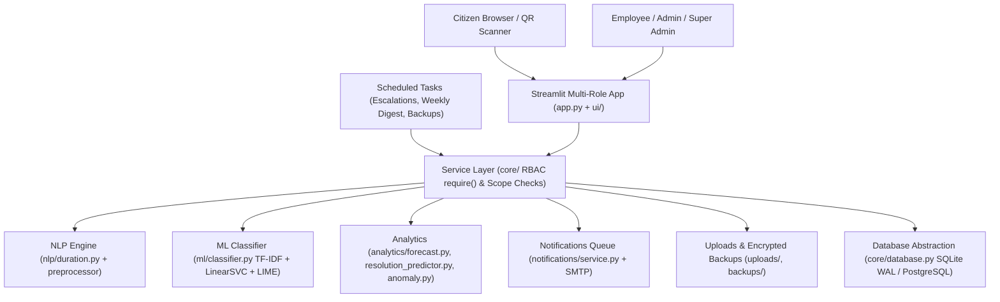
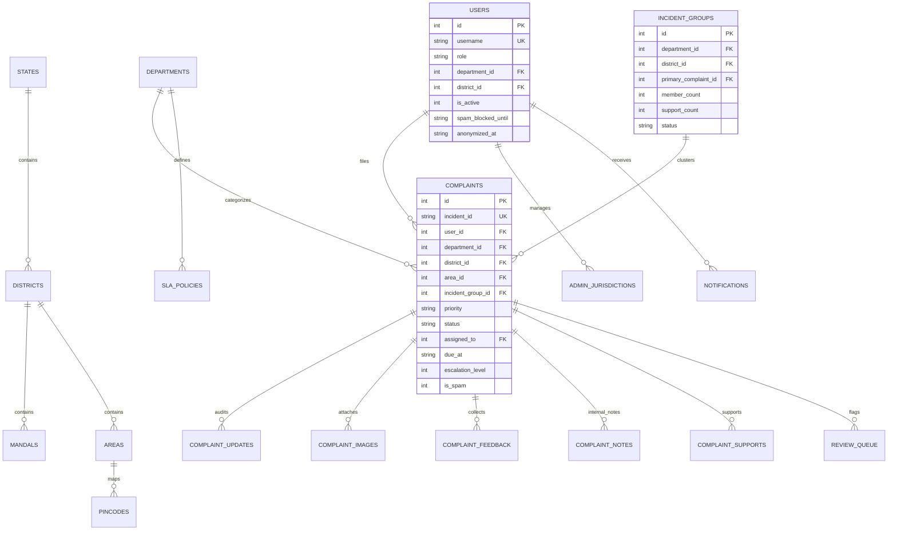
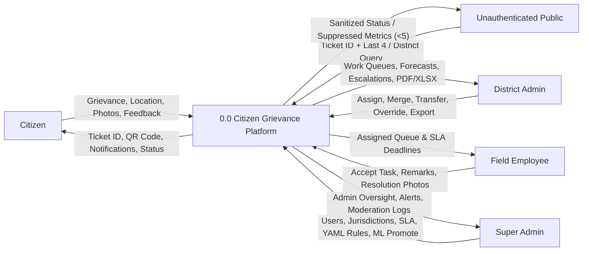
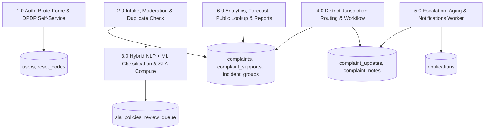
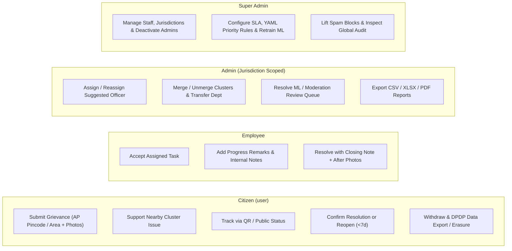
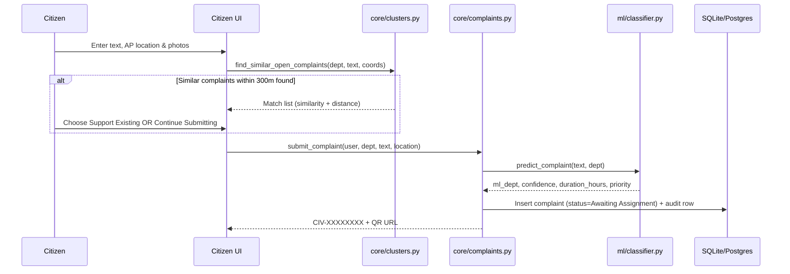
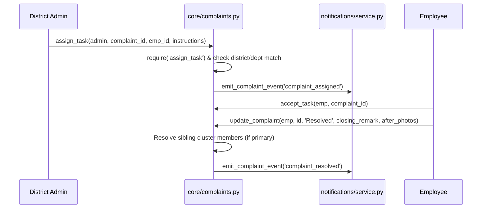
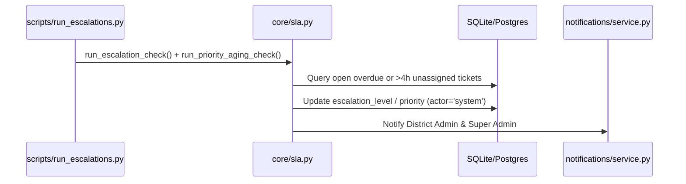

# System Architecture & Design Diagrams

## 1. System Architecture



## 2. Entity-Relationship Diagram (Core Tables)



## 3. Data Flow Diagram — Level 0 (Context Diagram)



## 4. Data Flow Diagram — Level 1



## 5. Role & Use Case Overview



## 6. Sequence Diagrams

### 6.1 Complaint Submission & Duplicate Detection


### 6.2 Admin Assignment & Employee Lifecycle


### 6.3 Scheduled Escalation & Priority Aging


### 6.4 Citizen Resolution Reopen Flow
```mermaid
sequenceDiagram
    participant C as Citizen
    participant SUB as core/complaints.py
    participant DB as SQLite/Postgres
    participant N as notifications/service.py

    C->>SUB: submit_feedback(citizen, id, accepted=False, rating, comment)
    SUB->>SUB: Verify ownership, Resolved status & <=7 day window
    SUB->>DB: Insert complaint_feedback; set status='Reopened', new due_at, reopen_count+1
    SUB->>N: Notify assigned Employee & District Admin
```
