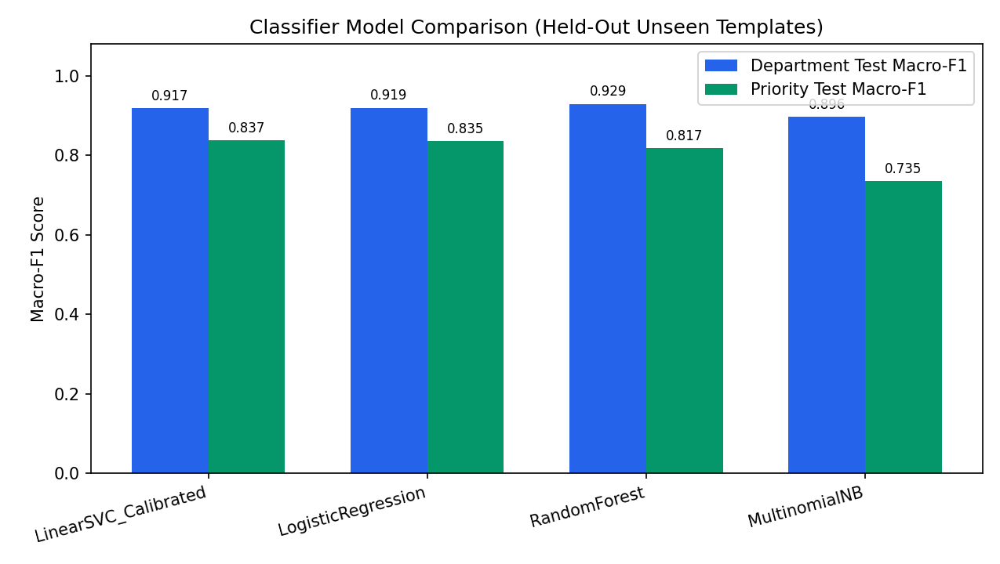
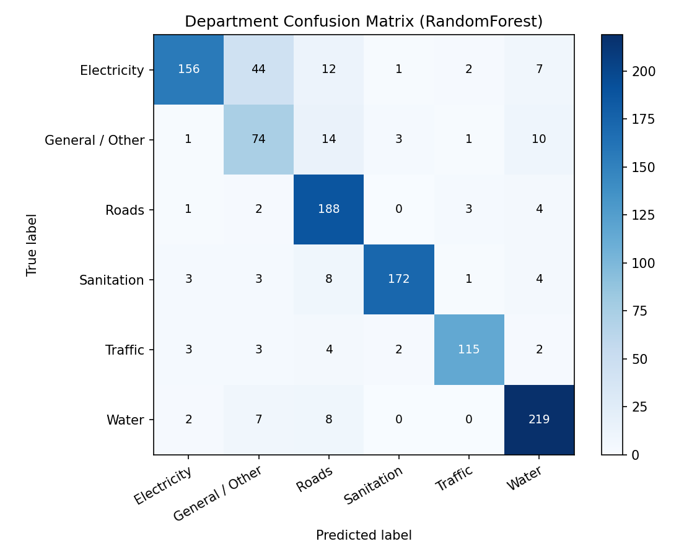
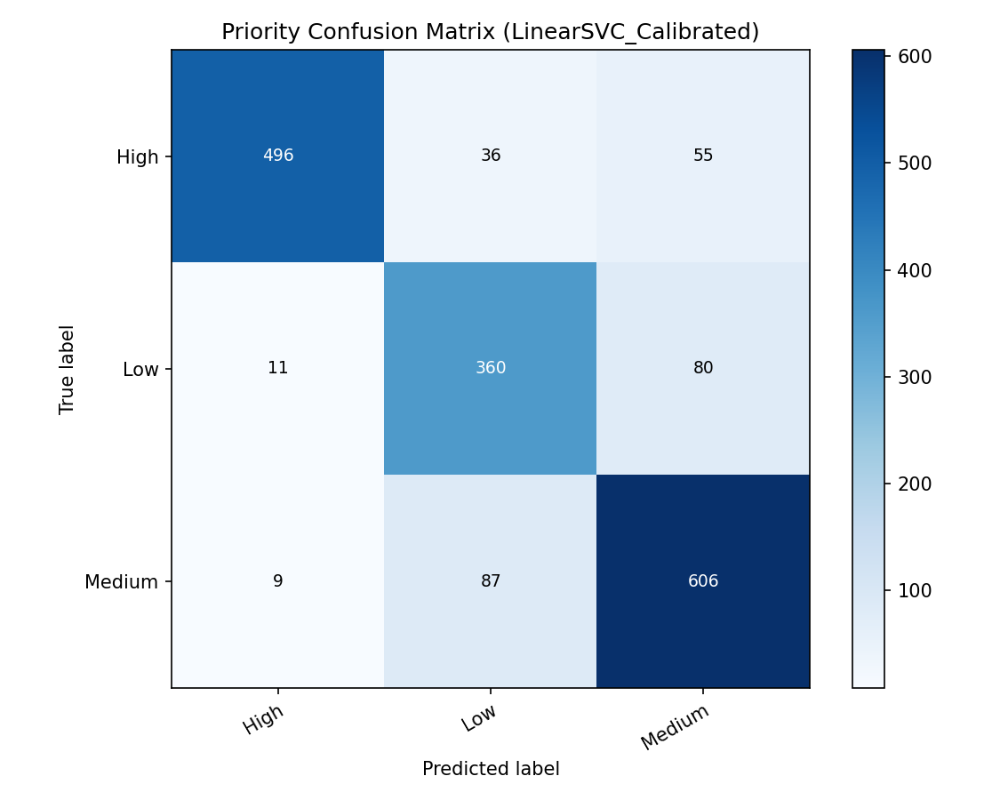
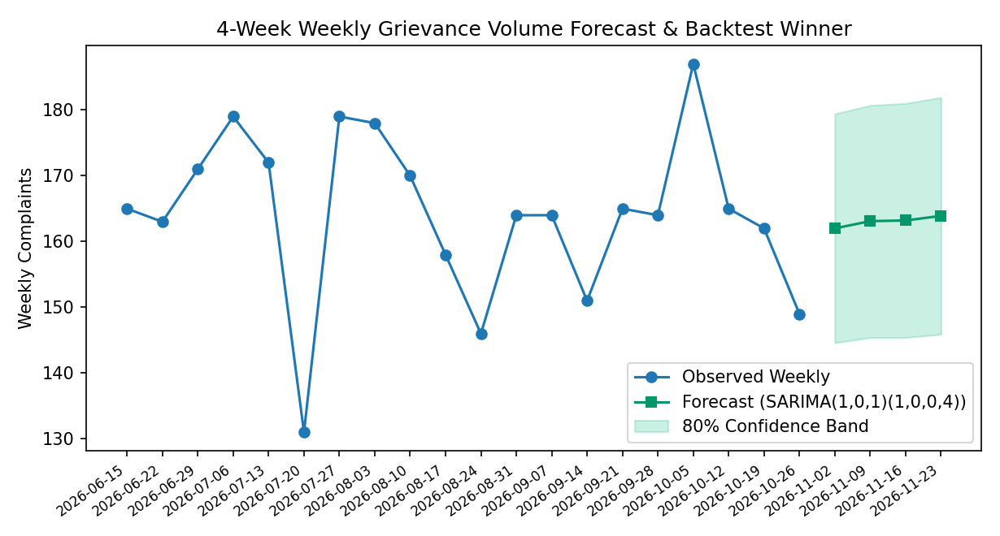
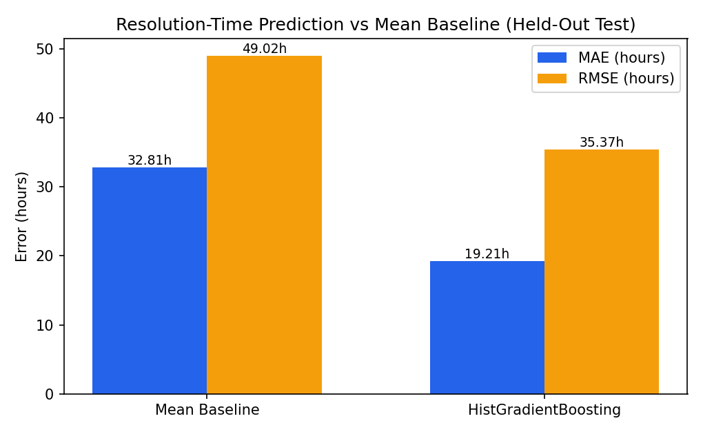

# ML Evaluation Report — Citizen Grievance Governance Platform

> **Dataset Notice:** All benchmark numbers below were measured on `data/synthetic_complaints.csv` (**8,700 100% synthetic** multilingual civic complaints, `is_synthetic=True`, `528` unique `template_group` phrasings across 6 departments and 4 language modes: English `en`, Telugu `te`, Hindi `hi`, and code-mixed `mixed`). Live/unreviewed DB rows were excluded cleanly during offline evaluation (`--db non_existent_eval.db`).

---

## 1. Split Strategy & Leakage Prevention

- **StratifiedGroupKFold (5 folds)** grouped by `template_group`: paraphrases from the same template never cross between train and validation/test folds.
- Held-out test split: **6,960** training rows vs **1,740** unseen-template test rows (`0` shared template groups).
- Evaluated artifact version: **`20261128_084902`** (`Python 3.14.3`, `scikit-learn 1.8.0`, `pandas 3.0.2`, `numpy 2.4.4`, `joblib 1.5.3`).
- **Leakage Check:** Zero ML metrics reach 100% (Department best `0.9224`, Priority best `0.8402`).

---

## 2. Department Classification Benchmark (Unseen Templates)

Features: Combined word TF-IDF `(1, 2)` (`max_features=6,000`, `sublinear_tf=True`) + character TF-IDF `char_wb (3, 5)` (`max_features=8,000`, `sublinear_tf=True`) + `DurationNumericFeatures`.

| Model | CV Acc (Std) | CV Macro-F1 (Std) | Test Acc | Macro Prec | Macro Rec | Macro-F1 | Fit (s) | Infer (ms / 1,740) |
|---|---:|---:|---:|---:|---:|---:|---:|---:|
| **LinearSVC (Calibrated)** *(CV Winner)* | **0.9136** (0.0185) | **0.9096** (0.0184) | 0.9224 | 0.9210 | 0.9155 | 0.9174 | 3.32 | 10.63 |
| LogisticRegression | 0.9067 (0.0187) | 0.9016 (0.0191) | 0.9230 | 0.9201 | 0.9181 | 0.9184 | 1.17 | 3.01 |
| RandomForest | 0.9000 (0.0235) | 0.8972 (0.0244) | **0.9316** | **0.9340** | **0.9245** | **0.9282** | 3.35 | 43.32 |
| MultinomialNB | 0.8862 (0.0314) | 0.8836 (0.0309) | 0.8937 | 0.9068 | 0.8944 | 0.8965 | 0.01 | 1.96 |

### Department Confusion Matrix

---

## 3. Priority Classification Benchmark & Safety Rule

| Model | CV Acc (Std) | CV Macro-F1 (Std) | Test Acc | Macro Prec | Macro Rec | Macro-F1 | Fit (s) | Infer (ms / 1,740) |
|---|---:|---:|---:|---:|---:|---:|---:|---:|
| **LinearSVC (Calibrated)** *(CV & Test Winner)* | **0.8440** (0.0058) | **0.8404** (0.0060) | **0.8402** | **0.8415** | **0.8355** | **0.8367** | 1.52 | 6.89 |
| RandomForest | 0.8343 (0.0060) | 0.8321 (0.0072) | 0.8144 | 0.8159 | 0.8227 | 0.8135 | 1.76 | 33.67 |
| LogisticRegression | 0.8339 (0.0092) | 0.8310 (0.0091) | 0.8362 | 0.8340 | 0.8331 | 0.8325 | 0.99 | 1.92 |
| MultinomialNB | 0.7063 (0.0167) | 0.6992 (0.0144) | 0.7391 | 0.7470 | 0.7305 | 0.7354 | 0.01 | 2.49 |

- **Production Safety Precedence:** `Emergency Keywords > Duration Threshold Rules > ML Prediction > Keyword Rule` (+1 level on recurring complaints). No ML prediction can ever lower an emergency or duration-threshold priority.

---

## 4. Feature & Preprocessing Ablation Study (Winning Estimator: `LinearSVC_Calibrated`)

| Experiment | Held-Out Dept Acc | Dept Macro-F1 | Held-Out Priority Acc | Priority Macro-F1 |
|---|---:|---:|---:|---:|
| `word_unigram_1_1` (TF-IDF `(1,1)`, sublinear) | 0.9034 | 0.9002 | 0.7989 | 0.7925 |
| `word_bigram_1_2` (TF-IDF `(1,2)`, sublinear) | 0.9103 | 0.9045 | 0.8052 | 0.7992 |
| `char_wb_3_5` (Char TF-IDF `(3,5)` only) | 0.9034 | 0.9048 | 0.8391 | 0.8356 |
| `stop_words_english` (`stop_words="english"`) | 0.8672 | 0.8610 | 0.7736 | 0.7686 |
| `clean_text_enabled` (`model/preprocessing.clean_text`) | 0.6569 | 0.6493 | 0.7569 | 0.7514 |
| `tfidf_raw_tf` (`sublinear_tf=False`) | 0.8655 | 0.8588 | 0.8000 | 0.7941 |
| `tfidf_only` (Word `(1,2)` + Char `(3,5)`, sublinear) | 0.9201 | 0.9144 | **0.8460** | **0.8431** |
| **`both` (Full Production FeatureUnion + Duration Features)** | **0.9224** | **0.9174** | 0.8402 | 0.8367 |

### Key Ablation Takeaways
- **Why ASCII-only text cleaning (`clean_text`) hurts:** Applying `re.sub(r"[^a-zA-Z\s]", "", text)` strips Devanagari and Telugu script characters as well as numeric duration tokens (`3 days`, `48 hours`), collapsing Department Macro-F1 from **0.9144 -> 0.6493** (-26.5 points). Raw Unicode preservation is essential.
- **Why English stopwords harm priority & mixed phrasing:** Removing words such as `"no"`, `"not"`, `"for"`, `"since"`, `"days"` degrades priority (`0.7992 -> 0.7686`) and department (`0.9045 -> 0.8610`).
- **Character n-grams + `sublinear_tf=True`:** Sublinear TF scaling (`1 + log(tf)`) outperforms raw TF (`0.9045` vs `0.8588` dept F1), and `char_wb (3,5)` is the single strongest feature block for noisy multilingual priority text (`0.8356` priority F1).

---

## 5. Multilingual Bias & Subgroup Evaluation (`n = 1,740` Held-Out Rows)

| Language Slice | Support (n) | Dept Acc | Dept Macro-F1 | Priority Acc | Priority Macro-F1 |
|---|---:|---:|---:|---:|---:|
| `en` (English) | 983 | 0.9207 | 0.9179 | 0.8372 | 0.8362 |
| `hi` (Hindi) | 350 | 0.8857 | 0.8791 | 0.8543 | 0.8502 |
| `te` (Telugu) | 259 | 0.9653 | 0.9527 | 0.8726 | 0.8594 |
| `mixed` (Code-mixed) | 148 | 0.9459 | 0.9386 | 0.7703 | 0.7628 |

- **Honest Bias Discussion:** Notice `mixed` code-switched complaints (English + transliterated Telugu/Hindi, e.g., `"tap water muddy ga vastundi"`) score **0.7628** Priority Macro-F1 vs **0.8594** for native-script Telugu (`te`). Transliterated phrasing varies heavily in spelling (`"vastundi"` / `"vasthundi"`, `"nhi"` / `"nahi"`), and `mixed` also has lower training support (`148` held-out rows), creating urgency-calibration variance across informal Hinglish/Tenglish text. Collecting human-verified Admin corrections through `priority_feedback_log` directly reduces this gap over time.

---

## 6. Error Analysis

Top held-out department confusion pairs (`grievance_ml_20261128_084902.json`):
1. **Traffic -> General / Other (20):** Informal parking/obstruction templates lacked strong keywords (`signal`, `junction`).
2. **Water -> Roads (17):** Complaints mentioning waterlogging or broken pipelines along named road corridors shared roadway vocabulary (`ring road`, `junction`).
3. **General / Other -> Roads (16):** Sidewalk/obstruction items near main roads overlapped with road maintenance terms.
4. **Sanitation -> Roads (7) / General / Other -> Water (7):** Drain overflow and roadside dumping share mixed street context.

Top priority confusion pairs centered around **Medium <-> Low (`87` + `80`)** when complaints lacked explicit numeric durations, which is mitigated in production by the Review Queue + deterministic duration rules.

---

## 7. Phase 2: Volume Forecasting, Resolution-Time Prediction & Anomaly Detection

### 7.1 Weekly Volume Forecast (4-Week Horizon, Rolling-Origin Backtest)

Evaluated on 53 contiguous weekly buckets comparing `SARIMA(1,0,1)(1,0,0,4)` against a 4-week `Seasonal-Naive Baseline` across 8 rolling origins. Whenever SARIMA does not beat the baseline MAE, the system explicitly reports this and falls back to the **Seasonal-Naive Baseline**.

| Scope | Weeks | Active Selected Model | Seasonal-Naive MAE | Naive MAPE (%) | SARIMA MAE | SARIMA MAPE (%) | Next Wk Est | Suggested Handlers |
|---|---:|---|---:|---:|---:|---:|---:|---:|
| **All Combined** | 53 | `SARIMA(1,0,1)(1,0,0,4)` | 11.095 | 6.68 | **8.475** | **5.12** | 162.0 | 11 |
| **Water** | 53 | `Seasonal-Naive Baseline` *(won)* | **5.143** | **17.59** | 5.309 | 18.44 | 28.0 | 2 |
| **Roads** | 53 | `SARIMA(1,0,1)(1,0,0,4)` | 6.833 | 21.75 | **4.438** | **15.09** | 32.3 | 3 |
| **Electricity** | 53 | `SARIMA(1,0,1)(1,0,0,4)` | 4.821 | 17.18 | **4.191** | **14.95** | 25.1 | 2 |
| **Sanitation** | 53 | `SARIMA(1,0,1)(1,0,0,4)` | 8.976 | 36.30 | **5.943** | **25.69** | 30.4 | 3 |
| **Traffic** | 53 | `SARIMA(1,0,1)(1,0,0,4)` | 8.607 | 37.95 | **4.703** | **18.23** | 22.9 | 2 |
| **General / Other** | 53 | `Seasonal-Naive Baseline` *(won)* | **7.095** | 29.85 | 7.128 | **28.99** | 33.0 | 3 |

### 7.2 Resolution-Time Prediction (`HistGradientBoostingRegressor`)

Trained on `5,930` resolved records (`4,594` train / `1,336` template-grouped held-out test) using `department`, `priority`, `district`, `hour`, `weekday`, and `text_length`:

| Model | Held-Out MAE (hours) | Held-Out RMSE (hours) | Notes |
|---|---:|---:|---|
| Mean Baseline (`40.62h`) | 32.810 | 49.023 | Constant historical mean |
| **`HistGradientBoostingRegressor`** | **19.213** | **35.368** | **Beats baseline (-41.4% MAE, -27.9% RMSE)** |

All citizen and staff resolution times are presented clearly as **estimates only** (`is_estimate=True`), with department-priority baseline fallback when no model artifact is loaded.

### 7.3 Rolling-Window Spike / Anomaly Detection

`analytics/anomaly.py` monitors `(district, department)` complaint counts inside configurable 2-hour windows (`CGS_ANOMALY_WINDOW_HOURS=2`) against trailing 7-day baselines using `z >= 2.5` (`CGS_ANOMALY_ZSCORE`) plus optional `IsolationForest` outlier verification. Detected spikes generate deduplicated alerts for both matching District Admins and Super Admin; `scripts/inject_spike.py` allows repeatable `[DEMO SPIKE]` simulation and cleanup (`--remove`).
